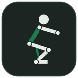
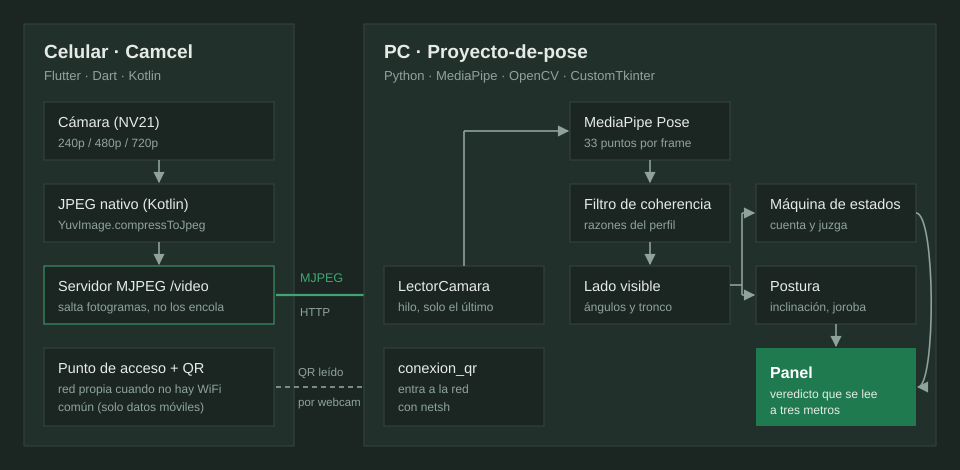
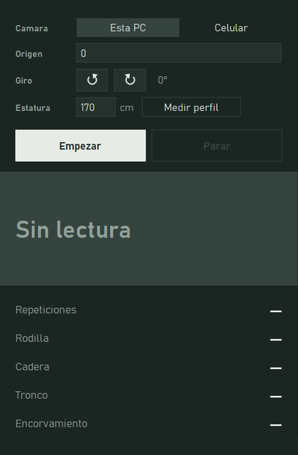
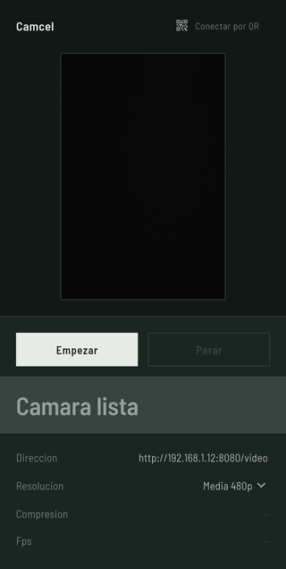
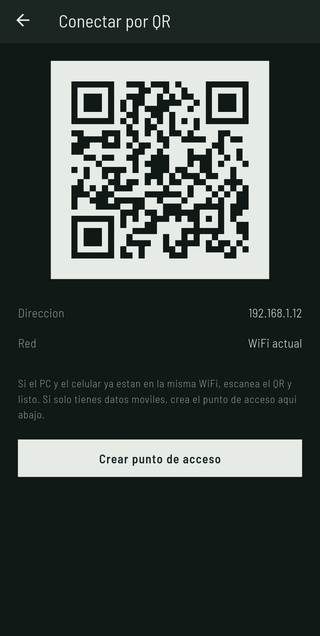
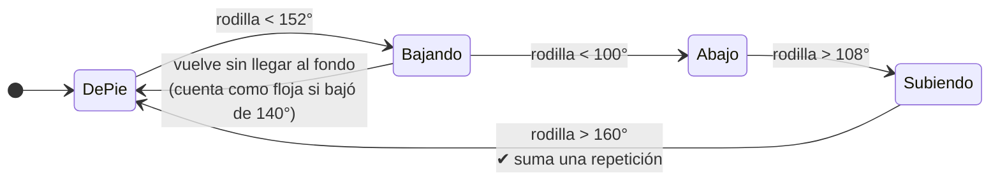
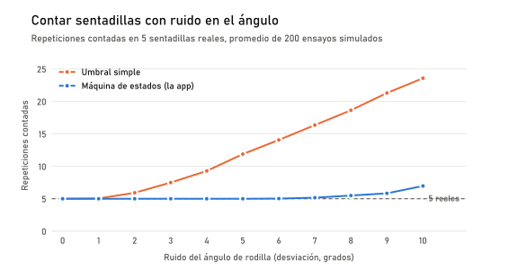
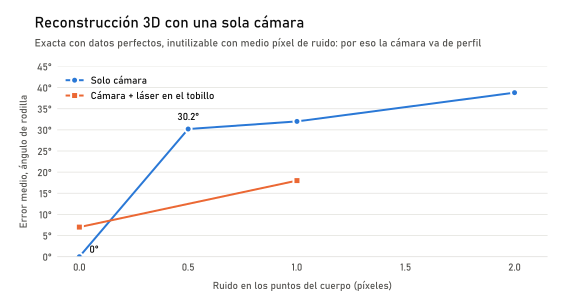

<div align="center">



# Corrección de sentadilla con la cámara

**Un sistema que mira cómo haces una sentadilla y te dice qué corregir, en tiempo real,<br>con la cámara del celular y visión por computador en el PC.**

    

Semillero de investigación · Ingeniería Mecatrónica · José Vargas

</div>

---

## Qué hace

Te paras de perfil frente a la cámara y haces sentadillas. El sistema:

- **Cuenta las repeticiones** y juzga cada una: si bajaste lo suficiente y si la espalda se mantuvo bien durante todo el recorrido, no solo al final.
- **Mide la postura**: ángulo de rodilla y de cadera, inclinación del tronco e índice de encorvamiento.
- **Muestra un veredicto de color** pensado para leerse de reojo a tres metros, mientras haces el ejercicio.

La cámara es la del celular. Para eso hice **Camcel**, una app Android propia que transmite el video al PC, incluso cuando no hay una red WiFi en común.

## Arquitectura



| Carpeta | Qué es | Tecnología |
|---|---|---|
| [`Proyecto-de-pose/`](Proyecto-de-pose) | App de escritorio: detección de pose, medidas, conteo y panel | Python, MediaPipe, OpenCV, CustomTkinter |
| [`camcel/`](camcel) | App Android que convierte el celular en cámara de red | Flutter, Dart, Kotlin |

<table>
<tr>
<td width="420"></td>
<td>

### El panel

Diseñado para usarse **de lejos**, con el cuerpo en movimiento:

- El veredicto es un **campo de color a todo el ancho**, no una etiqueta.
- Las medidas van como **hoja de datos**, con el grado pegado a la cifra.
- **Histéresis** en el veredicto, para que no parpadee cuando un valor ronda el límite.
- Contrastes medidos: 12.9:1 el texto, 5.3:1 los campos de estado (WCAG pide 4.5:1).
- Tipografía Bahnschrift, la DIN que trae Windows.

</td>
</tr>
</table>

<table>
<tr>
<td width="240"></td>
<td width="240"></td>
<td>

### Camcel

La app del celular sigue el **mismo lenguaje visual** que la de escritorio: la misma paleta, esquinas rectas y el estado en un campo de color.

- **Empezar / Parar** controlan el servidor MJPEG. Parar corta de verdad a los clientes conectados, sin quedarse esperando a que terminen de leer.
- **Conectar por QR** muestra la dirección. Sin WiFi común, crea un punto de acceso y pone en el QR la red y la clave para que el PC entre solo.
- Las dos apps comparten el **mismo ícono**, generado por un solo script.

</td>
</tr>
</table>

## Decisiones de ingeniería

Cada decisión de este proyecto se tomó **midiendo**. Estas son las que más pesaron.

### 1. Contar con una máquina de estados, no con un umbral

La forma obvia de contar sentadillas es sumar una cada vez que el ángulo de rodilla baja de cierto valor. Falla con el temblor normal de los puntos que entrega MediaPipe: el ángulo cruza el umbral de ida y vuelta varias veces y una sentadilla se cuenta como tres.

La app recorre el ciclo completo y solo suma al cerrarlo:



Simulado con el contador real del proyecto, sobre 5 sentadillas y 200 ensayos por nivel de ruido:

<picture>
  <source media="(prefers-color-scheme: dark)" srcset="docs/img/conteo_oscuro.svg">
  
</picture>

Con un umbral simple, **2° de ruido ya suman una repetición de más**. La máquina de estados cuenta **5 de 5 exactas hasta 6° de ruido**, muy por encima de lo que tiembla MediaPipe en la práctica.

### 2. La cámara va de perfil, y no fue por gusto

Antes de fijar el ángulo de grabación intenté **reconstruir la pierna en 3D con una sola cámara**. Sabiendo cuánto mide cada hueso de la persona, cada articulación solo puede estar en dos puntos del espacio (un rayo cortando una esfera), y el pie apoyado en el suelo permite elegir el correcto.

La geometría es exacta, pero no aguanta el ruido real:

<picture>
  <source media="(prefers-color-scheme: dark)" srcset="docs/img/reconstruccion_oscuro.svg">
  
</picture>

El problema está mal condicionado justo con la pierna recta, que es como empieza toda sentadilla. También simulé un **sensor láser de distancia**. Para el tronco sirve mucho: 1° de error frente a 4–9° de la imagen. Para la rodilla no sirve, porque la ambigüedad está en la rodilla y ningún sensor mira ahí.

**Conclusión:** de perfil, la flexión de rodilla y la inclinación del tronco se miden en 2D sin reconstruir nada. El costo queda anotado: el valgo de rodilla (rodillas hacia adentro) solo se ve de frente.

### 3. Encorvamiento que no se confunde con inclinarse

MediaPipe no tiene ningún punto entre los hombros y la cadera, así que la columna no se puede leer directamente. El índice de encorvamiento mide cuánto se adelanta la oreja **respecto al eje del propio tronco**, no respecto a la imagen. Así, agacharse con la espalda recta no da falsa alarma. El umbral (0.08) salió de calibrar con mi propio cuerpo y coincide con fotos de referencia.

### 4. Detectar cuándo MediaPipe se equivoca

Las proporciones de una persona no cambian de un fotograma a otro. La app mide una vez tu **perfil corporal** y descarta los fotogramas donde la razón fémur/tibia o tronco/fémur se sale de la tuya: ahí MediaPipe perdió un punto. Se usan **razones** y no longitudes porque una razón no cambia al acercarse ni al girarse. La primera versión normalizaba por el ancho de caderas, que de perfil mide 2 px, y rechazaba todo.

También se mide **sobre el lado que la cámara ve**. De perfil, la pierna tapada la rellena MediaPipe adivinando, y si su visibilidad no pasa de 0.5 no se mide.

### 5. Video en vivo: perder fotogramas antes que atrasarse

| Problema | Antes | Después |
|---|---|---|
| Video a tirones en el celular | YUV → JPEG en Dart, píxel a píxel | Compresor JPEG nativo en Kotlin |
| Retraso que crecía hasta **un minuto** | Colas en el socket y en `VideoCapture` | Los dos extremos descartan y se quedan con el último fotograma |
| Interfaz lenta en el PC | Inferencia en el hilo de la interfaz: **46.1 ms** entre eventos | Hilo propio: **17.3 ms** |
| Sin red WiFi común (solo datos móviles) | El PC no alcanza la IP del operador | El celular crea su punto de acceso y muestra un QR; el PC lo lee con la webcam y se conecta solo |

## Cómo ejecutarlo

**App de escritorio** (Windows, Python 3):

```bash
cd Proyecto-de-pose
python -m venv .venv
.venv\Scripts\activate
pip install -r requirements.txt
python app_pose.py
```

Los modelos de MediaPipe (`models/pose_landmarker_lite.task`) se descargan aparte desde la [página de Pose Landmarker](https://ai.google.dev/edge/mediapipe/solutions/vision/pose_landmarker).

**Camcel** (Android, con el celular conectado por USB):

```bash
cd camcel
flutter build apk
flutter install
```

Abre Camcel, pulsa Transmitir y, en la app de escritorio, elige **Celular** con la IP que muestra el teléfono, o lee su QR.

**Pruebas** (no necesitan cámara):

```bash
python -m doctest Proyecto-de-pose/conteo_sentadillas.py Proyecto-de-pose/app_pose.py
```

## Documentación

- [Bitácora técnica, entrada 1](Proyecto-de-pose/bitacora_tecnica.pdf): Fases 1 y 2, ángulos, postura, Camcel y latencia.
- [Bitácora técnica, entrada 2](Proyecto-de-pose/bitacora_tecnica_2.pdf): Fase 3, conteo, perfil corporal, reconstrucción 3D y conexión por QR.
- Cada commit explica el problema y cómo se resolvió: el historial es el diario de trabajo.

## Estado

- [x] Detección de pose, ángulos y postura de espalda
- [x] Camcel: transmisión de baja latencia, punto de acceso y QR
- [x] Conteo de repeticiones con juicio por repetición
- [x] Perfil corporal y filtro de detecciones erróneas
- [ ] Calibrar la profundidad con sentadillas reales
- [ ] Retroalimentación durante el ejercicio y migración de la lógica al celular

<sub>Las gráficas se regeneran con `python docs/generar_graficas.py`, y el ícono con `python Proyecto-de-pose/generar_icono.py`.</sub>
